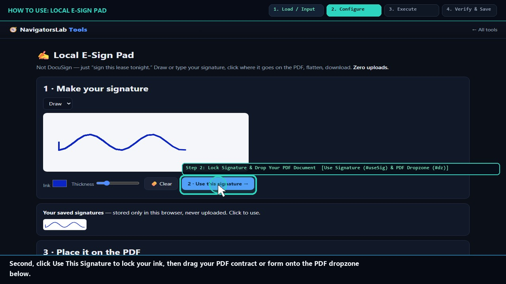
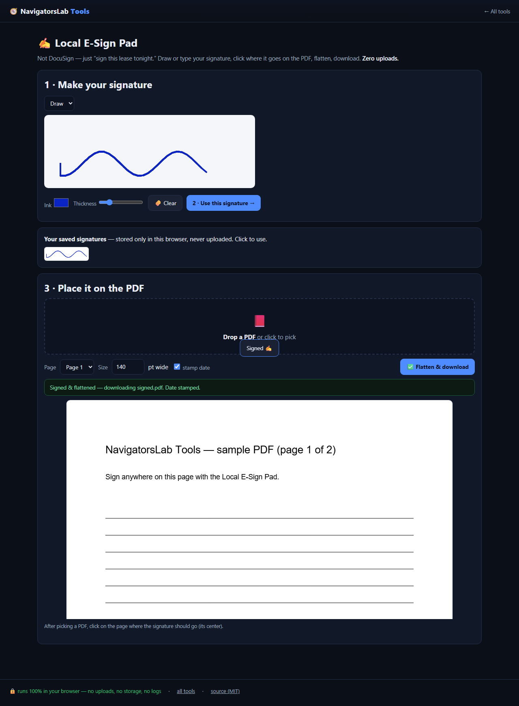

# ✍ Local E-Sign Pad

> Sign this lease tonight — not DocuSign

     

<h4 align="center">
  &#9654; <a href="https://navigatorslab.com/tools/sign.html">Open it on navigatorslab.com</a> &mdash; free, no sign-up, nothing uploaded<br>
  <a href="https://navigatorslab.com/E-Sign-Pad">navigatorslab.com/E-Sign-Pad</a> &middot; <a href="https://navigatorslab.com/tools/videos/sign.mp4">🔊 Watch Narrated Step-by-Step Tutorial Video</a> &middot; <a href="https://navigatorslab.com/tools/videos/notebooklm-overview.mp4">Watch Full Suite Hands-On Video</a><br>
  This repo's Pages site runs the <em>actual tool</em>: <code>demo.html</code>
</h4>



Draw or type a signature, click to place, flatten into the PDF — with an optional dated caption under the ink.

## 📖 Complete Step-by-Step User Guide

### Step 1: Draw or Type Your Signature on the Ink Pad (`Signature Pad Canvas (#pad)`)
- **How to do it:** Draw your signature smoothly on the `#pad` canvas using a mouse, finger, or stylus (or switch to the **Type** tab to generate a calligraphic signature from your typed name).
- **Expected result:** High-resolution transparent ink strokes are captured locally.

### Step 2: Lock Signature & Drop Your PDF Document (`Use Signature (#useSig) & PDF Dropzone (#dz)`)
- **How to do it:** Click **Use this signature (`#useSig`)**, then drop the `.pdf` file you need to sign onto `#dz`. Select the target page number from the page dropdown (`#pageSel`).
- **Expected result:** The selected PDF page renders live on the preview canvas (`#cv`).

### Step 3: Enable Date Stamp & Click Page to Place Signature (`Stamp Date (#addDate) & Page Canvas (#cv)`)
- **How to do it:** Check **Stamp today's date (`#addDate`)** and adjust the signature size slider if needed. Click directly on the signature line on the PDF preview canvas (`#cv`) to position your ink.
- **Expected result:** Your signature and date stamp appear at the exact coordinates you clicked.

### Step 4: Flatten & Download Signed PDF (`Flatten & Download Button (#stamp)`)
- **How to do it:** Click **Flatten & download signed PDF (`#stamp`)**. `pdf-lib` embeds the signature XObject and date text directly into the page content stream.
- **Expected result:** Signed, flattened `.pdf` saved to your machine—nothing ever left your browser.

## 🎛️ UI Controls, Shortcuts & Parameters Reference

| Control / Shortcut | What It Does |
|---|---|
| `Signature Pad (`#pad`) & Clear (`#clearPad`)` | Pressure-aware pointer canvas supporting mouse, touch, and pen/stylus input. |
| `Use this signature (`#useSig`)` | Captures the drawn ink as a transparent PNG ready for placement on any PDF page. |
| `Page Selector (`#pageSel`) & Stamp Date (`#addDate`)` | Switch between pages of a multi-page PDF and optionally append the current date below the signature. |
| `Flatten & download (`#stamp`)` | Bakes the signature and date into the PDF page content stream and downloads the signed PDF. |

## 💡 Pro Tips & Real-World Workflows

- 💡 On a laptop trackpad, draw slightly larger across the full width of `#pad`, then use the scale control to size it down neatly onto narrow signature lines.
- 💡 Need to sign on multiple pages (e.g., initialing Page 1 and signing Page 4)? Place and stamp Page 1, then drop the resulting PDF to sign Page 4.
- 💡 Because the ink is flattened into the page stream rather than added as a floating annotation, recipients cannot accidentally drag or delete your signature.

## 🧪 Concrete Example: Input → Engine → Output

| Stage | What Happens | Details |
|---|---|---|
| **1. Raw Input** | **Mutual-NDA-2026.pdf (Unsigned)** | Counterparty needs a signed PDF tonight — no printer, no scanner, no DocuSign account |
| **2. On-Device Engine** | **Draw/type signature on HTML5 pad -> place on pdf.js page preview -> flatten directly into PDF page resources** | Runs 100% client-side in your browser tab under strict `CSP` (`connect-src 'none'`). |
| **3. Verified Output** | **Mutual-NDA-2026-signed.pdf** | Ink & dated caption ('Signed 2026-11-08') permanently flattened into PDF content stream; 0 editable form fields |

```text
Signature embedded in Page 1 /Resources/XObject | AcroForm fields: 0 (Flattened) [OK]
```

- 🔊 **Narrated Step-by-Step Usage Tutorial Video (`38s`):** [`demo.mp4`](./demo.mp4) (also live at [`https://navigatorslab.com/tools/videos/sign.mp4`](https://navigatorslab.com/tools/videos/sign.mp4))
- 🎬 **Full Suite Hands-On Video Guide:** [`https://navigatorslab.com/tools/videos/notebooklm-overview.mp4`](https://navigatorslab.com/tools/videos/notebooklm-overview.mp4)

## ✅ What it does

- Draw or type a signature, place it anywhere on a PDF, optional dated caption
- Fully local — contracts never leave your machine
- Works with mouse, trackpad, stylus and touch

## 🚀 Try it in 30 seconds

1. Open the PDF
2. Draw or type your signature, click to place it
3. Download the flattened, signed PDF

## 📸 Live UI in action



## 🔒 Private by design

- **100% on-device** — files are processed in your browser and **never uploaded** to any server
- **No accounts, no tracking, no cookies, nothing retained** — open the page and work
- **Works offline** once loaded; fully mobile-friendly
- **Free & open source (MIT)** — use it at home, at work, anywhere

## 🤖 Built for humans *and* AI agents

- Deep-linkable via URL parameters — see the [Agent Mode guide](https://navigatorslab.com/tools/agents.html)
- Machine-readable catalog: [llms.txt](https://navigatorslab.com/tools/llms.txt) · [llms-full.txt](https://navigatorslab.com/tools/llms-full.txt)
- MCP endpoint: `POST https://navigatorslab.com/tools/mcp` (tool catalog + deterministic text tools — see the [main repo](https://github.com/Kayforkind/NavigatorsLab-Tools))
- No build step required to *use* any tool — just the URL

## 🛠 Under the hood

pdf-lib flattening; pointer events for mouse, touch and stylus

Third-party components are catalogued in [NOTICE](NOTICE); this repo is MIT-licensed ([LICENSE](LICENSE)).

## 🗂 The NavigatorsLab Tools suite

The full catalog — every tool in the hub with the same zero-upload promise, plus the lab's apps, CLIs and engines:

| Tool | What it does | |
|---|---|---|
| 🛡 Photo Privacy Kit | Strip GPS, camera model and timestamps before posting | [Open](https://navigatorslab.com/tools/exif.html) |
| 🔐 Password Breach Checker | Has this password been breached? — it never leaves your tab | [Open](https://navigatorslab.com/tools/breachcheck.html) |
| 🔍 Metadata & Hidden-Data Checker | See what's really inside a file — then strip it | [Open](https://navigatorslab.com/tools/metadata.html) |
| 🗜 Image Shrinker | Hit “max 2 MB” portal limits without TinyPNG | [Open](https://navigatorslab.com/tools/shrink.html) |
| 📄 Scan & Screenshot Cleaner | Phone photos of documents → clean, straight PDFs | [Open](https://navigatorslab.com/tools/scan.html) |
| **✍ Local E-Sign Pad** | Sign this lease tonight — not DocuSign | [Open](https://navigatorslab.com/tools/sign.html) |
| 🧾 Receipts → One PDF | Shoebox of receipt photos → one date-sorted PDF | [Open](https://navigatorslab.com/tools/receipts.html) |
| 🔢 Receipt OCR → CSV | Read totals off receipt photos, export for expenses | [Open](https://navigatorslab.com/tools/ocr.html) |
| 🔳 QR Studio | Generate QR codes and decode QR images — no site sees them | [Open](https://navigatorslab.com/tools/qr.html) |
| 🎧 Audio Trimmer | Cut voice notes and clips on a waveform | [Open](https://navigatorslab.com/tools/audio.html) |
| 🧮 Invoice / Quote Generator | One-person shops: hours in, clean PDF out | [Open](https://navigatorslab.com/tools/invoice.html) |
| 🗂 Batch Rename & Sort | IMG_5847.jpg → 2026-09-05-receipt-home-depot.jpg | [Open](https://navigatorslab.com/tools/rename.html) |
| 🖨 Print-Shop Prep | Exact sizes, bleed, DPI checks, print-ready PDF | [Open](https://navigatorslab.com/tools/printprep.html) |
| 📑 PDF Pages | Reorder, rotate, delete and extract PDF pages | [Open](https://navigatorslab.com/tools/pdfpages.html) |
| 🔬 Text Diff | Compare two texts with word-level highlights | [Open](https://navigatorslab.com/tools/textdiff.html) |
| 🎨 Reimagine | Redesign any HTML page from its own content | [Open](https://navigatorslab.com/reimagine/) |
| 📊 Text Stats | Words, reading time, readability, keyword density | [Open](https://navigatorslab.com/tools/textstats.html) |
| 📜 PDF Studio | Edit the text inside your PDF — private, free, open source | [Open](https://navigatorslab.com/pdf-studio/) |
| 🩺 Design Health | 18 deterministic design-quality checks for HTML — no LLM, no API key | [Open](https://github.com/Kayforkind/design-health-action) |
| 🔪 Skill Slice | Copy one Read-verified skill folder — a slice, not the pie | [Open](https://github.com/Kayforkind/skill-slice) |
| 🕵 liecatchers | Your agent said Done. Prove it — ten sensors, one RECEIPT.json | [Open](https://github.com/Kayforkind/liecatchers) |
| 📚 Book Guide MCP | Ship improvements with your books — agents cite, run playbooks, learn | [Open](https://github.com/Kayforkind/book-guide-mcp) |
| 📡 Data Insights | Founder intelligence — daily & weekly tech signal briefs | [Open](https://github.com/Kayforkind/data-insights) |
| 🪓 Iron Axe: Legacy | An original side-scrolling beat 'em up — Godot 4 | [Open](https://github.com/Kayforkind/iron-axe-legacy) |

---

<p align="center">
  <b>One hub, twenty-four projects:</b> <a href="https://navigatorslab.com/tools/">https://navigatorslab.com/tools</a><br>
  <b>Source &amp; the whole suite:</b> <a href="https://github.com/Kayforkind/NavigatorsLab-Tools">https://github.com/Kayforkind/NavigatorsLab-Tools</a>
</p>
